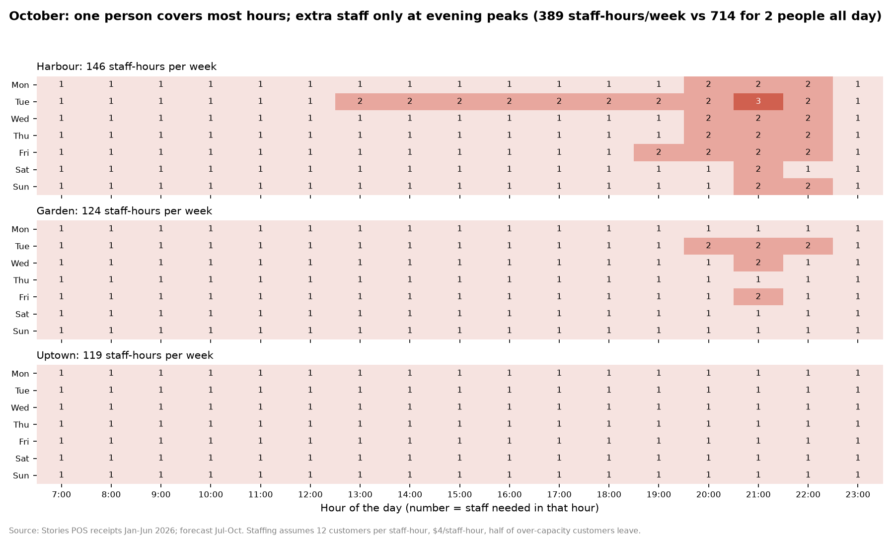
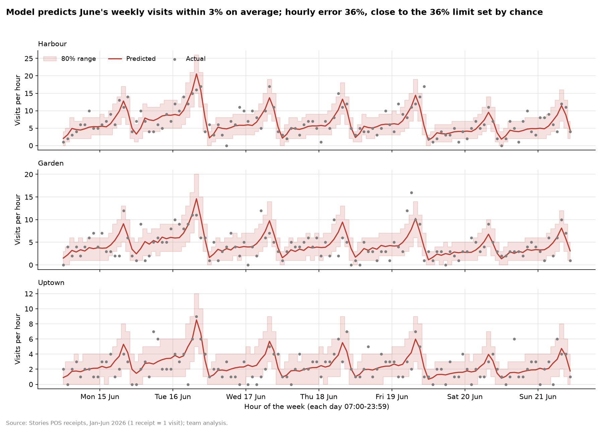
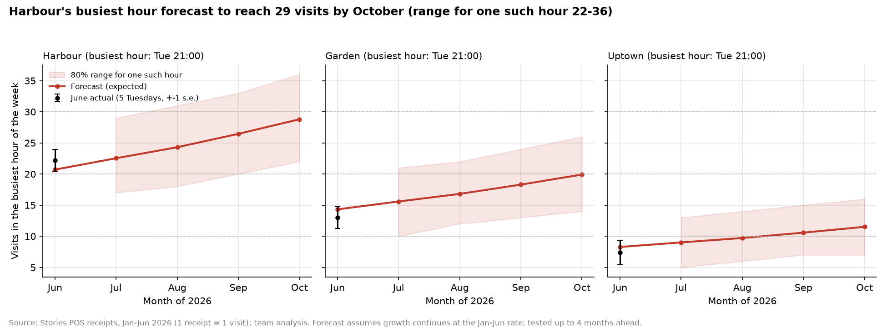

# ML staffing forecast: staffing Stories to predicted demand

**EECE490 Stories Coffee Hackathon**

**Team:** Christopher Ferzli, Samer Bannout

## Conclusion

Stories' customer flow is very predictable. Our model forecasts each branch's weekly customers within **3–4%** up to 4 months ahead, tested on months it never saw. Half of all customers arrive after 6pm, and Tuesday brings 1.5× a normal day. At 12 customers per staff-hour, one person covers almost every hour; a second is needed only in evening peaks, and a third only at Harbour on Tuesday at 9pm from August.

A rota built from the forecast needs **389 staff-hours a week in October**, against 714 for two people on every shift. That's worth about **$67k a year** at $4 an hour while losing under 1% of customers to queues, provided one person may run a quiet hour. If two people must always be present, the saving disappears, and the forecast's value is timing Harbour's extra evening staff.

Every dollar figure rests on stated assumptions; [forecast_report.md](forecast_report.md) shows which ones change the decision, and a practical test Stories can run first.





## Run

```bash
pip install -r requirements.txt
python forecast.py      # clean, model, tests, Jul-Oct forecast (~20 s)
python staffing.py      # rota, costs, value, sensitivity (~5 s)
```

The data is read from the repo's top-level [`data/`](../../data/) folder. Every output goes to `outputs/`.

## Try it in the browser

After running the scripts, open `app/index.html` in any browser; no server is needed.
- Pick a branch and a day to see the predicted customers and **staff needed** for every hour.
- Change "customers per staff-hour" to try your own assumption.
- For January–June, the actual counts appear next to the prediction. June days use the model trained on January–May only, so they are a real test.

## Use the trained model

```bash
python predict.py --branch Harbour --date 2026-07-14 --hour 21
```

Output: `expected 22.3 visits (80% range for this hour: 16-28)`. What the model learned is in `outputs/model_coefficients.csv`.
