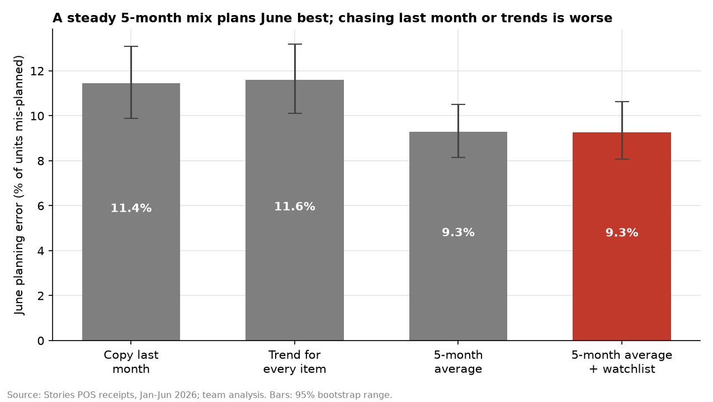

# Idea 4: Plan item prep from a steady mix, not last month

**Team:** Christopher Ferzli, Samer Bannout

## Conclusion

Each branch should plan an item's share of its category from the **average of the last five months**, not from last month. It should adjust only for a short **watchlist** of items with a steady trend, refreshed monthly. Tested on June, a month the rules never saw, the steady mix mis-planned **19% fewer units** than copying last month (9.3% against 11.4% error). Most monthly swings in item choice are noise that reverses: items that rose in one period mostly fell back in the next (correlation −0.59). A few items drift steadily; Strawberry Matcha gained 4.8 points of its category and Iced Matcha lost 4.5. The value is planning accuracy, worth at most about **$6.7k a year** of avoided waste.



**Full write-up:** [report.md](report.md), with the trend test, the reversal evidence, the June test, assumptions, weak areas and a pilot design.

## Run

```bash
python taste_shift.py
```
