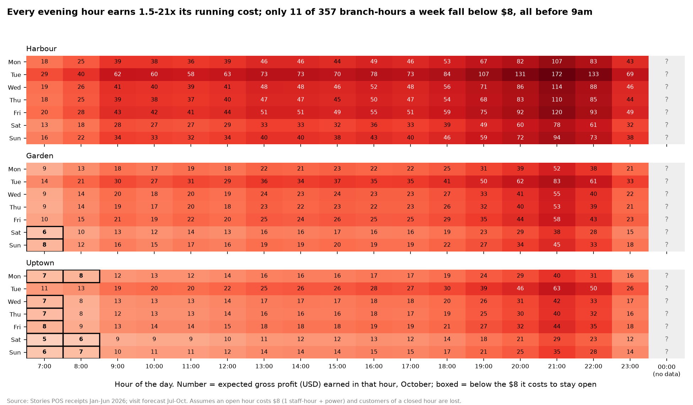

# Are Stories' opening hours right?

Every number comes from `outputs/hours_numbers.json` or the CSVs next to it, produced by `hours.py`.
**[MEASURED]** means computed from the data. **[ESTIMATED]** means it depends on stated assumptions.
**[SCENARIO]** means there is no data at all and the number is an illustration.

---

## Conclusion

**Don't close any branch earlier, but do test staying open later at Harbour.** Profit per customer is the same at every hour **[MEASURED]**, so an hour is worth keeping when it brings enough customers. With the visit forecast for October, every evening hour earns **1.5–22× the ~$8 it costs to stay open**. Only 11 of 357 branch-hours a week fall below that cost, all before 9am at Uptown and on Garden's weekend mornings **[ESTIMATED]**. Opening Uptown at 8:00 instead of 7:00 saves less than about **$1.3k a year**. It's worth doing only if an open hour really costs $10 or more.

The bigger opportunity is at the other end of the day. Orders don't slow down before midnight: they are flat in every 10-minute block through 23:59 **[MEASURED]**. Staying open until 01:00 at Harbour pays off if the extra hour brings just **12–25% of the 11pm hour's profit**, worth roughly **$1.3k–9.6k a year at Harbour [SCENARIO]**. No data exists after midnight, so no model can predict that hour. A 6-week pilot on Harbour's three strongest nights (Tuesday, Wednesday, Friday) is the only way to find out.

We tested the method on June, a month it never saw. Hours chosen with our forecast earned **4× more** than hours chosen from plain January–May averages ($156 against $37 in June, at $8 an hour) **[MEASURED]**. The averages ignored growth and cut hours that had become profitable.

---

## 1. The question

Stories opens all three branches 07:00–24:00 every day. Each open hour costs money: at least one staff member, plus power, which in Lebanon often means a generator. Each hour also brings profit from the customers who come. The decision for each branch and weekday:
- **open later?** (8:00, 9:00, 10:00 or 11:00)
- **close earlier?** (22:00 or 23:00)
- **stay open later?** (past midnight)

## 2. Method

1. **Profit per customer, by branch and hour [MEASURED]:**
   - it hardly changes through the day: Garden $4.04–4.36, Harbour $5.63–6.22, Uptown $4.93–5.73 (`hours_gp_per_receipt.csv`);
   - so an hour's value is essentially its number of customers × the branch's profit per customer.
2. **Customers per hour, July–October [ESTIMATED]:** from the visit forecast in [`../ml-staffing-forecast`](../ml-staffing-forecast). It's accurate to 3–4% on weekly totals up to 4 months ahead in tests.
3. **Expected profit per open hour** = forecast customers × profit per customer, for every branch × weekday × hour × month (`hours_break_even.csv`). This is also each hour's **break-even running cost**: close the hour only if an open hour costs more than this.
4. **Decision:**
   - For each branch and weekday, choose the opening time (7–11) and closing time (22–24) that maximise profit minus running cost.
   - It's done two ways: hours set per weekday, or the same hours every day (simpler to run).
5. **Assumptions:**
   - An open hour costs **$8**: one staff-hour (~$4) plus power and generator (~$4). Rent is paid anyway, so it isn't counted.
   - Customers of a closed hour are **lost**, none come at another time. This is the conservative choice for closing.

## 3. Results [ESTIMATED unless marked]

### Profit per open hour, October (chart: `outputs/chart_hours_october.png`)



- **Evenings:**
  - every hour from 18:00 to 24:00 earns at least **$11.7** (Uptown, Saturday 23:00), which is **1.5× the $8 cost**;
  - Harbour's 23:00 hour earns $32–69 a night.
- **Mornings:** the only hours below $8 are:
  - Uptown 07:00 every day except Tuesday;
  - Uptown 08:00 on Monday, Saturday and Sunday;
  - Garden 07:00 at the weekend.

### The decision for October

| Branch | Hours set per weekday | Same hours every day |
|---|---|---|
| Harbour | 07:00–24:00, unchanged | 07:00–24:00 |
| Garden | open 08:00 on Saturday and Sunday | 07:00–24:00 |
| Uptown | open 08:00 Wednesday–Friday, 09:00 Monday, Saturday and Sunday, 07:00 Tuesday | **open 08:00** |

**Value:** about **$1,313 a year** with hours set per weekday, **$860** with the same hours every day. That's small.

**Growth shrinks the case over time.** In July the same-every-day rule would open Garden at 8 and Uptown at 9. By October only Uptown at 8 remains (`hours_decision.csv`). The hours should be re-checked as the forecast updates each month.

### Tested on unseen data: June [MEASURED]

Each method chose hours using only January–May information. We then scored the choice on **actual June profit**: running cost saved minus real profit lost in the closed hours.

| Hours chosen from | Running cost/hour | Hours cut per week | Value it promised | Value it delivered in June |
|---|---|---|---|---|
| **Forecast model (trained Jan–May)** | $8 | 24 | $217 | **$156** |
| Baseline: Jan–May averages, no growth | $8 | 40 | $428 | **$37** |
| Hindsight: June's actual averages (best possible) | $8 | 29 | $289 | $283 |
| **Forecast model** | $12 | 51 | $871 | **$807** |
| Baseline | $12 | 68 | $1,353 | **$725** |
| **Forecast model** | $15 | 68 | $1,644 | **$1,645** |
| Baseline | $15 | 79 | $2,318 | **$1,479** |

- **The forecast beats the plain-average baseline at every cost level.** It delivers close to what it promises.
- **The baseline over-promises** by 1.6–12×. It ignores growth, so it cuts hours that had become profitable by June.
- This is the main reason to use the model rather than averages for this decision.

## 4. Assumptions that could change the decision

From `hours_sensitivity.csv`:

| Running cost per open hour | Customers of closed hours who come later anyway | Yearly value of trimming | What changes in October |
|---|---|---|---|
| $4 | 0% | $1 | nothing |
| $6 | 0% | $205 | Uptown opens 9:00 on Saturdays |
| **$8 (base)** | **0%** | **$1,313** | Uptown opens 8–9:00 on 6 days; Garden 8:00 at weekends |
| $10 | 0% | $3,464 | Garden opens 8:00 on most days; Uptown 9:00 on most days (11:00 Saturday) |
| $12 | 0% | $6,670 | + Uptown closes 23:00 on Saturdays |
| $15 | 0% | $13,685 | + Uptown opens 11:00 most days; Harbour opens 8:00 on Saturdays |
| $20 | 0% | $30,220 | + Harbour 9:00, Garden 11:00 on weak days |
| $8 | 25% | $3,298 | + Garden 9:00, Uptown 10–11:00 on weak days |
| $8 | 50% | $8,274 | wider morning and late-evening cuts |
| $8, Garden at Harbour's costs | 0% | $1,097 | Garden's weekend mornings become worth keeping |

**What changes the decision:**
- **The running cost per hour, most of all.** At $4 nothing changes, and at $6 almost nothing does. Closing any evening hour only makes sense above about $12.
- **Whether customers come at another hour when one is closed.** If half of them do, trimming is worth about 6× more.
- **Garden's cost-recording issue** (see `../ml-staffing-forecast`). Corrected, Garden earns more per customer and keeps its weekend mornings.

Stories can measure all three cheaply (§7).

## 5. After midnight: no data, so no model [MEASURED evidence + SCENARIO values]

Stories closes at midnight, so the data contains no customers after 24:00. A model can't learn what it has never seen, so we don't predict that hour. Instead:

**The evidence:**
- **Orders don't fade before closing.** Orders per 10-minute block, January–June:
  - 23:00 hour: 276, 278, 254, 311, 282, 281 (statistically flat, p = 0.31);
  - 22:00 hour: also flat (p = 0.44).

  The last sale is at **23:59:56**. Customers are still arriving when the door closes.
- **But demand can step down suddenly:** blocks fall from about 540 to about 280 at exactly 23:00. A flat 23:00 hour therefore doesn't prove the midnight hour would match it.
- **Harbour's 23:00 hour earned $16.7–39.4 profit per night,** January–June average, measured. Tuesday is highest, then Friday and Thursday. The forecast for October is **$32–69**.

**Break-even** (`hours_late_night.csv`): an extra hour costing $8 pays off if it earns at least this share of the 23:00 hour's profit:

| Branch | Break-even share of the 23:00 hour |
|---|---|
| Harbour | **12% (Tuesday) to 25% (Saturday)** |
| Garden | 24–53% |
| Uptown | 31–68% |

**Scenarios** (Harbour, only on nights where it pays):

| If the midnight hour earns this share of the 23:00 hour | Yearly value |
|---|---|
| 25% | $1.3k |
| 50% | $5.4k |
| 75% | $9.6k |

At Garden and Uptown, the extension only pays if the midnight hour earns more than about a third to two-thirds of 23:00. That's unlikely, so they aren't pilot candidates.

## 6. Alternative explanations

- **Are quiet mornings low demand, or low awareness?**
  - The data can't tell. Orders at 07:00–07:10 are no higher than the rest of the hour (p = 0.26 for flatness), so there is no crowd waiting at the door. That's evidence against opening *earlier*.
  - It doesn't show whether more people would come if they knew the shop was open, or if there were a breakfast offer.
- **Would late-night customers be new, or just shifted?** Some people now buying at 23:30 might simply come later if the shop stays open. That would add cost without adding profit. The pilot measures **the whole night's profit**, not only the extra hour, to catch this.
- **Would closing a morning hour lose more than that hour?** A regular who finds the door closed might stop coming at 9:00 too. That is a causal risk the data can't measure. The pilot checks whether daily profit falls by more than the cut hour's profit.
- **Correlation, not cause:** evening hours are busy, but staying open later doesn't *cause* more customers. Only the pilot shows a causal effect.

## 7. Practical tests before wider use

1. **Late-night pilot (6 weeks):**
   - **Setup:** Harbour stays open until 01:00 on Tuesday, Wednesday and Friday. Garden's hours are unchanged, as the comparison.
   - **Measure:** profit 00:00–01:00, profit 23:00–24:00, and the whole night's profit against the forecast's range.
   - **Keep it if:** the midnight hour averages above **12–25% of the 23:00 hour** (Tuesday–Friday) *and* the whole night's profit beats the forecast by more than the extra cost.
   - **Stop early if:** it falls below break-even for 3 weeks in a row.
2. **Morning trim pilot (6 weeks):**
   - **Setup:** Uptown opens at 08:00 instead of 07:00, except Tuesdays.
   - **Measure:** daily profit against the forecast's range, and whether 08:00–10:00 customers rise (people shifting) or the whole day drops by more than the cut hour (lost regulars).
3. **Measure the real hourly running cost (1 week):** read the generator and electricity meter per hour, and record wages. This replaces the $8 assumption, the input the decision depends on most.

## 8. Weak areas and possible failures

- **No data after midnight.** The late-night value is a scenario until the pilot runs.
- **Morning growth may be faster than forecast:**
  - in past tests the visit model under-predicted daytime hours by about 2% (see `../ml-staffing-forecast`);
  - profit per day in the 07:00 hour roughly doubled from January to June **[MEASURED]**: Harbour $7.87 → $15.49, Garden $3.81 → $6.80, Uptown $3.53 → $6.41.

  If that continues, even Uptown's 07:00 hour pays for itself within months. Recheck monthly.
- **The model gives every weekday the same daily shape.** The raw data hints that Uptown's 23:00 hour is weaker Thursday–Sunday ($7–9 a night) than Monday–Wednesday ($13–14). The model doesn't capture that, because per-weekday shapes predicted worse in testing.
- **Profit per customer uses recorded costs.** Garden's are probably overstated (see `../ml-staffing-forecast`).
- **The values are small** next to Stories' roughly $361k yearly gross profit **[MEASURED, annualised]**. This idea is mainly about not making a costly mistake (closing earlier) and testing one upside (staying open later).

## 9. Approaches rejected

| Approach | Why rejected |
|---|---|
| Predicting the midnight hour with a model (curve extension) | No data after 24:00; any number would be an assumption dressed as a prediction. |
| Deciding from plain January–June averages | Ignores growth; in the June test it delivered a quarter of the forecast's value. |
| Closing earlier in the evening | Every evening hour earns at least 1.5× its cost; it only pays above about $12 an hour. |
| Opening earlier than 07:00 | No sign of customers waiting at opening time. |

## 10. Reproduce

Run [`../ml-staffing-forecast`](../ml-staffing-forecast) first, because this idea uses its forecast. Then:

```bash
cd opening-hours
python hours.py
```

The data file is read from the repo's top-level `data/` folder. The run takes about 5 seconds.

| Output | Content |
|---|---|
| `hours_gp_per_receipt.csv` | profit per customer by branch and hour (measured) |
| `hours_break_even.csv` | expected profit per edge hour by branch, month and weekday = break-even running cost |
| `hours_decision.csv` | chosen hours per branch, weekday and month, with yearly value |
| `hours_june_test.csv` | out-of-sample test of the decision against the baseline and hindsight |
| `hours_sensitivity.csv` | decision under each running cost, customer-shift share and Garden cost variant |
| `hours_late_night.csv` | 23:00 profit, break-even shares and scenarios for staying open later |
| `hours_numbers.json` | every key number in this report |
| `chart_hours_october.png` | profit per open hour, October |
