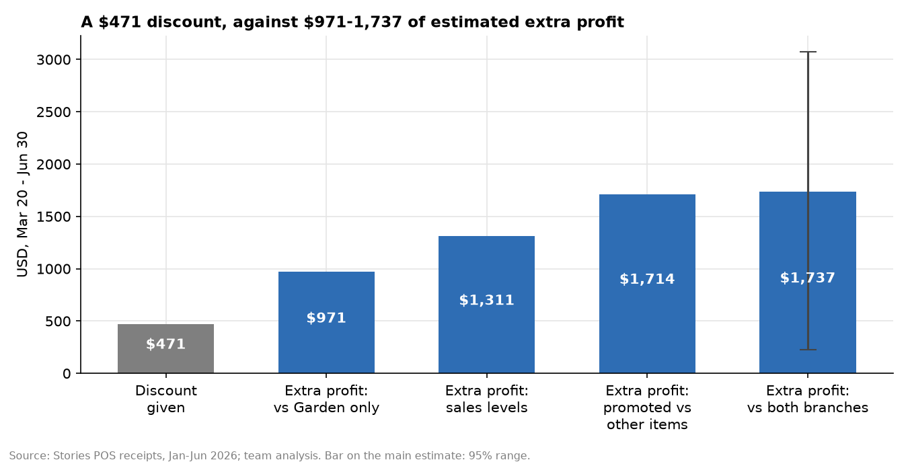

# Idea 4: Habit-building promotions: judge discounts over eight weeks, not one

**Team:** Christopher Ferzli, Samer Bannout

## Conclusion

Harbour's 15%-off week on cold coffee and desserts looks like a loss if it's judged on the promotion week alone. After the discount ended, though, Harbour kept selling more of those items than the other branches for three months: an estimated **+11% to +15%**, depending on the method. Its other items didn't change, and none of 28 fake start dates or 500 random item sets produced a lift this large. Measured that way, the **$471** discount brought in about **$971–1,737** of extra gross profit. The evidence is suggestive, not conclusive: the lift is clear against Uptown but small and uncertain against Garden alone. Stories should run one randomised promotion (about $500) and follow it for eight weeks before changing how it judges promotions.



**Full write-up:** [report.md](report.md), with the method, every robustness check, the main caveat and the test design.

## Run

```bash
python promo_habit.py
```
