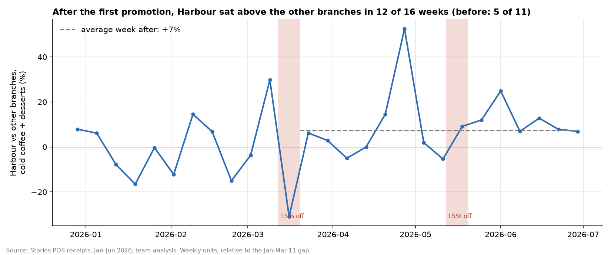
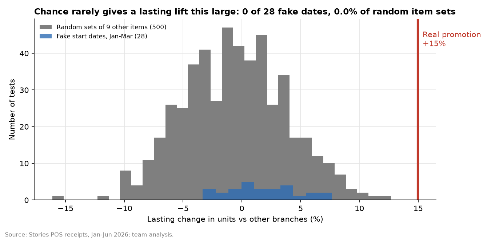

# Habit-building promotions: judge discounts over eight weeks, not one

Every number comes from `outputs/promo_numbers.json` or the CSVs next to it, produced by `promo_habit.py`.
**[MEASURED]** means computed from the data. **[ESTIMATED]** means it depends on stated assumptions.

---

## Conclusion

Harbour's 15%-off week on cold coffee and desserts looks like a loss if it's judged on the promotion week alone. But after the discount ended, Harbour kept selling more of those items than the other branches did, for three months: an estimated **+11% to +15%**, depending on the method **[MEASURED]**. Measured that way, the **$471** discount brought in about **$971–1,737** of extra gross profit **[ESTIMATED]**. The evidence is **suggestive, not conclusive**: the lift is clear against Uptown but small and uncertain against Garden alone. Stories should run **one randomised promotion (about $500) and follow it for eight weeks** before changing how it judges promotions.

---

## 1. The promotion, as recorded [MEASURED]

- **Offer:** 15% off **9 items** (Brownie, Cheesecake Slice, Coffee Frappe, Cold Brew, Frozen Yoghurt Cup, Iced Americano, Iced Latte, Iced Mocha, Tiramisu Cup).
- **Where and when:** at **Harbour only**, on **March 12–19** and **May 12–19**.
- **Cost:** the discount cost **$470.63**.

## 2. Method

We compared Harbour with Garden and Uptown over the same days, before the first promotion (January 1 – March 11) and after it (March 20 – June 30), leaving out both promotion weeks. Comparing branches on the same days removes overall growth, the weekly pattern, and anything else that hit all three branches. Technically, this is a difference-in-differences with branch and date effects, on the log of daily units.

## 3. Results [MEASURED]

| Comparison | Lasting lift on the 9 items (95% range) | p |
|---|---|---|
| **Harbour vs both other branches** (main) | **+15.0%** (+1.7% to +30.0%) | 0.026 |
| Same, in sales levels (bigger branches weigh more) | +10.9% (−1.1% to +24.3%) | 0.076 |
| Promoted vs other items, within each branch | +14.8% (+3.3% to +27.5%) | 0.010 |
| Harbour vs Garden only | +7.9% (−8.8% to +27.5%) | 0.38 |
| Harbour vs Uptown only | +22.6% (+0.1% to +50.1%) | 0.049 |
| **Harbour's other items** (not promoted) | **+0.0%** (−5.1% to +5.5%) | 0.99 |

- **Customers added these items rather than swapping.** Harbour's other items didn't change, so the extra sales weren't taken from elsewhere on the menu.
- **The timing fits** (`promo_weekly_gap.csv`). Before the promotion, Harbour sat above the other branches in **5 of 11** weeks, about what chance gives. After it, Harbour sat above them in **12 of 16** weeks.

  
- **Chance rarely produces this** (`promo_chance_checks.csv`). We reran the same test where no promotion happened:
  - **28 fake start dates** in January–March (before the real promotion): **0** reached +15%;
  - **500 random sets of 9 other items** at Harbour: **0** reached it.

  

## 4. Value and the main caveat [ESTIMATED]

The extra profit is Harbour's gross profit on the 9 items after the promotion ($13,331) × lift ÷ (1 + lift):

| Method | Extra gross profit, Mar 20 – Jun 30 |
|---|---|
| vs Garden only (cautious) | **$971** |
| sales levels | $1,311 |
| promoted vs other items | $1,714 |
| vs both branches (main) | **$1,737** (95% range $225–3,074) |

Every method's estimate beats the **$471** discount. The main estimate was still adding about **$149 a week** in June.


**The main weakness is Uptown.** Uptown's sales of these items grew only **+17%** after March, while its other items grew **+27%**. Harbour's grew +38% against +28%, and Garden's +29% against +24% (`promo_growth_by_branch.csv`). Much of the lift therefore comes from Uptown falling behind. Against Garden alone, the lift (+7.9%) could be chance. In sales levels, where Uptown counts for less, the lift is +10.9% and not statistically clear (p = 0.08).

**Assumptions:**
- No other marketing ran at Harbour from March onwards.
- No local change, such as a new competitor near Uptown, explains Uptown's drop.
- We can't confirm that the *same* customers kept returning, because customer IDs carry no usable signal (see [`../../data-audit`](../../data-audit)).

**Correlation, not cause:** the lift follows the promotion in time, and the placebo checks make chance unlikely. But only a randomised test can show that the promotion *caused* it.

## 5. Recommended test

1. **Setup:** pick one branch **at random** and give it a week of 15% off cold coffee and desserts (about $500 of discount). The other two branches are the comparison.
2. **Follow-up:** track all three for **eight weeks** after the offer ends.
3. **Success:** the lift stays clearly above zero *and* the extra profit over those eight weeks beats the discount.
4. **If it holds:** repeat at a second branch, then judge every promotion on 8-week profit.
5. **If it doesn't:** keep judging promotions on short-term break-even only.

## 6. Approaches rejected

| Approach | Why rejected |
|---|---|
| Judging the promotion on its own week | Misses any effect that lasts after the offer ends. |
| Before/after at Harbour alone | Confounded by chain-wide growth: other items grew +24–28% at every branch. |
| Claiming the lift is proven | Not robust to the choice of control branch or weighting (§4). |

## 7. Reproduce

```bash
cd promotion-habit
python promo_habit.py
```

It reads the CSV from the repo's top-level `data/` folder and runs in about 1 minute (500 placebo regressions).

| Output | Content |
|---|---|
| `promo_numbers.json` | every key number |
| `promo_weekly_gap.csv`, `promo_chance_checks.csv`, `promo_growth_by_branch.csv` | evidence tables |
| `promo_weekly_gap.png`, `promo_chance_checks.png`, `promo_money.png` | charts |
