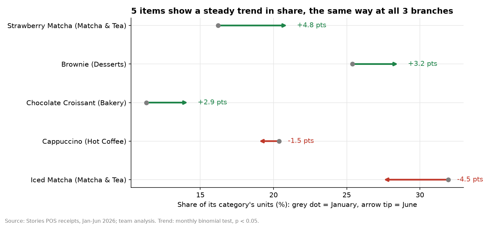
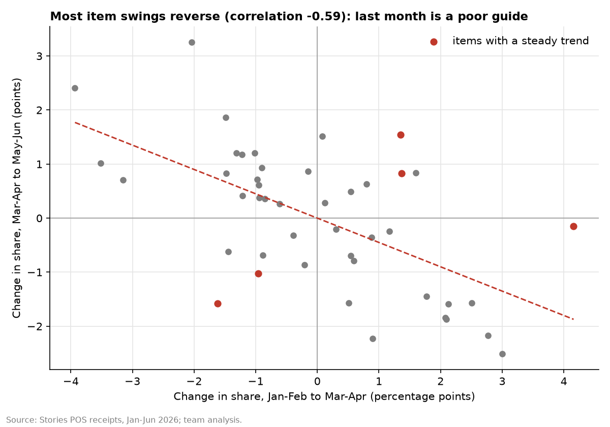

# Plan item prep from a steady mix, not last month

Every number comes from `outputs/taste_numbers.json` or the CSVs next to it, produced by `taste_shift.py`.
**[MEASURED]** means computed from the data. **[ESTIMATED]** means it depends on stated assumptions.

---

## Conclusion

Each branch should plan an item's share of its category from the **average of the last five months**, not from last month alone. It should adjust only for a short **watchlist** of items with a steady trend, refreshed monthly. We tested this on June, a month the rules never saw. The steady mix mis-planned **19% fewer units** than copying last month: 9.3% error against 11.4% **[MEASURED]**. Most month-to-month swings in item choice are noise that **reverses**: items that rose in March–April mostly fell back in May–June (correlation −0.59) **[MEASURED]**. A handful of items do drift steadily; Strawberry Matcha gained 4.8 points of the Matcha & Tea category, and Iced Matcha lost 4.5. The value is in planning accuracy, not profit: at most about **$6.7k a year** of avoided waste **[ESTIMATED, upper bound]**.

---

## 1. The question

Every branch decides how much of each item to prepare. Within a category, say Matcha & Tea, which items do customers pick? Iced Matcha, Strawberry Matcha, Classic Matcha? If those preferences change, prep plans need to change too. If the month-to-month changes are just random ups and downs, reacting to them makes planning worse. This idea asks which is happening, and which planning rule works best.

## 2. Five items show a steady trend; the list is a watchlist, not proof [MEASURED]

**The test** (`taste_item_trends.csv`): for each of the **45** items, a binomial regression of its units against the rest of its category, with branch effects and a monthly time trend.

**Five items** have a significant trend (p < 0.05), where chance alone would give about **2.25**. All five also:
- moved the same way at all three branches;
- were significant in a daily version of the test.

| Item | Share of its category, January → June | Change |
|---|---|---|
| Strawberry Matcha | 16.2% → 21.0% of Matcha & Tea | **+4.8 pts** |
| Brownie | 25.4% → 28.6% of Desserts | **+3.2 pts** |
| Chocolate Croissant | 11.3% → 14.2% of Bakery | **+2.9 pts** |
| Cappuccino | 20.4% → 18.9% of Hot Coffee | **−1.5 pts** |
| Iced Matcha | 31.9% → 27.4% of Matcha & Tea | **−4.5 pts** |

- **Borderline:** Iced Americano (+2.9 points; p = 0.058 monthly, 0.042 daily).
- **Caution:** with 45 items tested, some false alarms are expected. No item stays significant after correcting for that (smallest adjusted p = 0.07). About two of the five could be chance.
- **Hence a watchlist, not proof:** follow these items monthly; don't treat the list as settled.
- **A possible pattern:** three of the four rising or borderline items are sweet or indulgent, which hints at a drift toward treats. It's a pattern worth watching, not a proven trend.



## 3. For everything else, swings are noise that reverses [MEASURED]

- **Branches mostly disagree:** they move the same way on only **26.7%** of items, about what chance gives (25%).
- **Swings reverse:** an item that gained share from January–February to March–April usually lost it again by May–June. The correlation between one period's change and the next is **−0.59**, and only **28.9%** of items kept moving the same way (`taste_reversal.csv`).

So if a branch boosts prep for an item because it sold well last month, it will usually be wrong.



## 4. The June test: a steady mix plans best [MEASURED]

**Setup:**
- We pretended it was the end of May and planned every item's June share at every branch with four rules, using only January–May data.
- Each share was multiplied by the branch's actual June category total, so the test isolates the *mix* question.
- Each plan was scored against what actually sold (`taste_june_test.csv`).

| Planning rule | June error (95% range) | Units mis-planned |
|---|---|---|
| Copy last month's mix | **11.4%** (9.9–13.1%) | 1,257 |
| Fit a trend for every item | **11.6%** (10.1–13.2%) | 1,273 |
| Average of the last 5 months | **9.3%** (8.2–10.5%) | 1,020 |
| **5-month average + watchlist** | **9.3%** (8.1–10.6%) | **1,017** |

- **The steady average beats copying last month by 2.2 points** (95% range 0.8 to 3.5 points), a clear win: 19% fewer units mis-planned.
- **Fitting a trend for every item is worse** than the average, by 2.3 points (0.8 to 3.8), because it chases noise.
- **The watchlist** (built from January–May only: Chocolate Croissant, Brownie, Cappuccino, Iced Matcha) barely changes the total. On those four items, the trend rule's error was 7.4% against 7.5% for the plain average. Simply using last month's share did better there, at 5.5%. For items with a real trend, the latest month is the best guide, which is worth confirming in the pilot.


## 5. What it's worth, honestly

- **The shift in tastes is not a profit story.** The rising items earn about the same profit per unit as those they replace. Moving from January's mix to June's, at June volumes, is worth about **−$60 a month** **[ESTIMATED]**.
- **The value is in planning accuracy.** In June the steady-mix rule mis-planned **240 fewer units** than copying last month. If each mis-planned unit wasted its average cost ($2.34), that's at most about **$6.7k a year** **[ESTIMATED, upper bound]**. The real figure is lower, because not every planning error becomes waste.
- **The limit:** branches plan prep **daily**, and at the daily level chance dominates. The error is about **44%** whichever rule is used **[MEASURED]**. The steady mix fixes each item's *share*; branches still need buffers for day-to-day swings. Our visit forecast in [`../ml-staffing-forecast`](../ml-staffing-forecast) can size the daily total.

## 6. Assumptions, alternative explanations and weak areas

- **Assumption:** a mis-planned unit costs at most its ingredient cost. Real waste and stock-out costs aren't in the data.
- **Seasonality:** six months is short for taste trends. Some moves could be seasonal; Iced Matcha falling into summer would be surprising, which points to taste rather than weather. The data can't separate the two.
- **Who changed?** Customer IDs carry no usable signal (see [`../../data-audit`](../../data-audit)), so we can't tell whether the same people changed their order or new customers prefer different items.
- **Correlation, not cause:** a rising share doesn't show *why*. Menu placement, staff suggestions or stock-outs of a rival item could all move shares.

## 7. A test Stories can run

1. **Rule pilot (1 month):**
   - **Setup:** one branch plans prep with the five-month average plus the watchlist; the other two keep their current method.
   - **Measure:** waste and stock-outs per item at each branch.
   - **Roll out if:** waste falls without more stock-outs. Then refresh the watchlist monthly at every branch.
   - **Bonus:** also try "last month's share" for watchlist items (§4).
2. **Taste drift (8 weeks):** try a limited-time flavoured item, such as a new matcha flavour, at one branch and watch its share.

## 8. Approaches rejected

| Approach | Why rejected |
|---|---|
| Copy last month's mix | Swings reverse; 2.2 points worse in the June test. |
| Fit a trend for every item | Chases noise; 2.3 points worse than the average. |
| Treat every significant item as a real trend | No item survives a correction for testing 45 items. |

## 9. Reproduce

```bash
cd taste-shift
python taste_shift.py
```

It reads the CSV from the repo's top-level `data/` folder and runs in about 5 seconds.

| Output | Content |
|---|---|
| `taste_item_trends.csv` | trend test for all 45 items |
| `taste_reversal.csv` | share changes per two-month block |
| `taste_june_test.csv` | the four planning rules on June |
| `taste_numbers.json` | every key number |
| `taste_movers.png`, `taste_reversal.png`, `taste_june_test.png` | charts |
